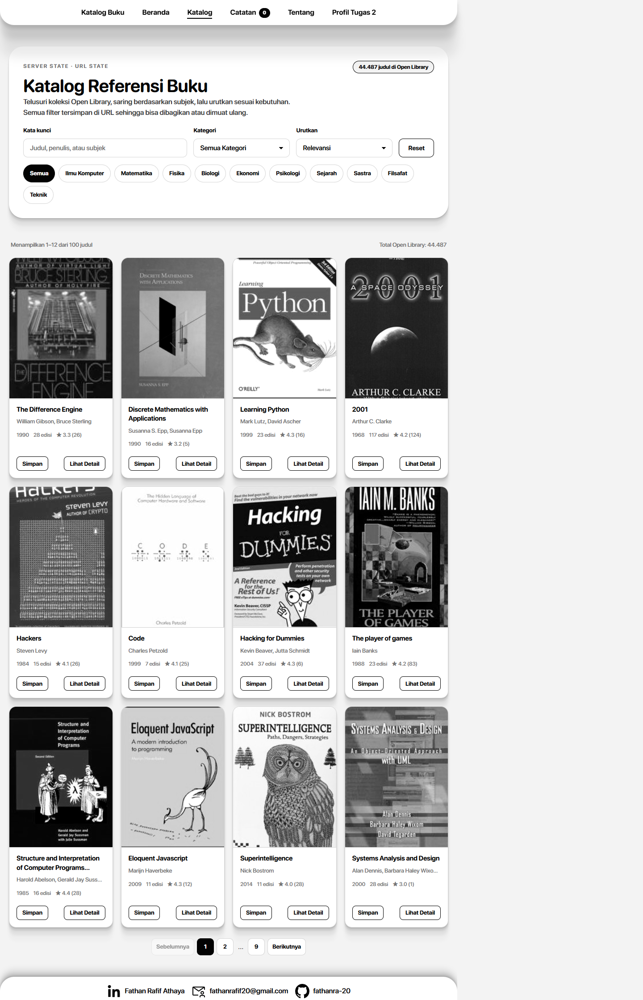
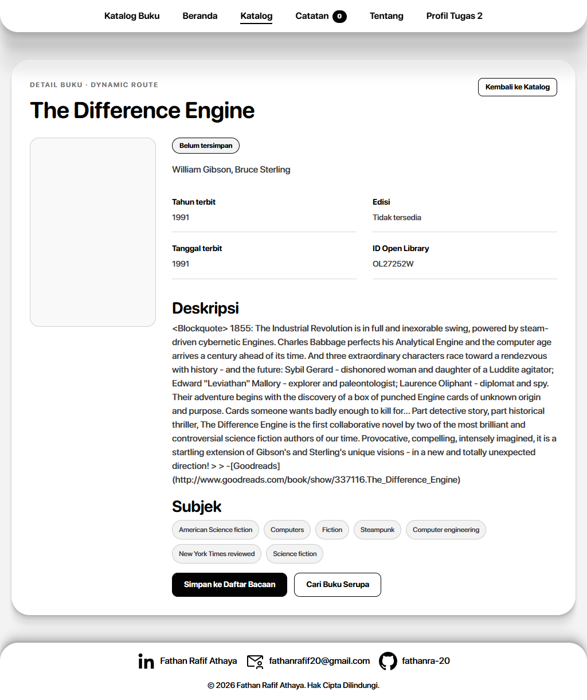
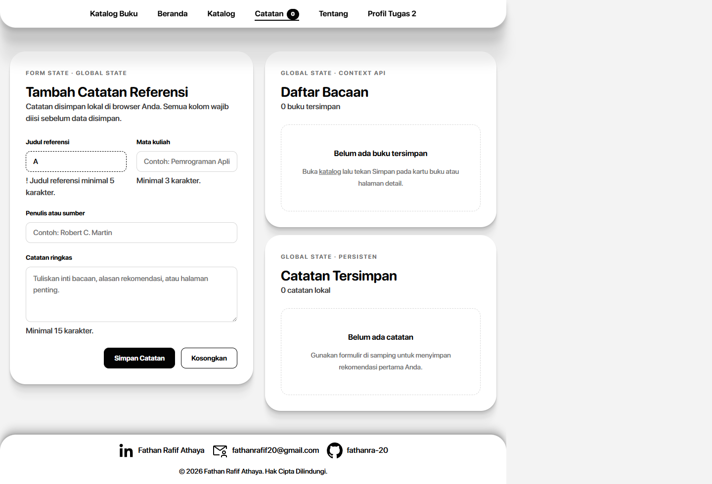

# Katalog Referensi Buku Akademik

Aplikasi katalog untuk menelusuri buku akademik, menyimpan referensi, dan mengelola rekomendasi bacaan.

**Mahasiswa:** Fathan Rafif Athaya  
**NIM:** 1247050044 — S1 Teknik Informatika, Semester 5  
**Profil:** [fathanra.vercel.app](https://fathanra.vercel.app)

## Demo produksi dan repository

- [Live Demo — Katalog Referensi Buku Akademik](https://fathanra-catalog.vercel.app)
- [Repository GitHub — F-Academic-Book-Catalog](https://github.com/fathanra-20/F-Academic-Book-Catalog)

## Bukti screenshot







## Fitur utama

- Mencari buku dari Open Library API, dengan tampilan loading, error, dan empty state.
- Mencari, memfilter, mengurutkan, dan membagi daftar katalog ke halaman.
- Membuka detail buku melalui rute dinamis, menyimpan bookmark, dan membuat catatan rekomendasi dengan validasi formulir.

## Routing dan navigasi

`react-router-dom` menangani client-side routing tanpa memuat ulang seluruh dokumen. `MainLayout` menjadi layout induk dengan navbar, area `Outlet`, dan footer. Rute detail buku menggunakan parameter dinamis `/katalog/:id`; tautan navigasi memakai `Link` atau `NavLink` sesuai kebutuhan.

## Pengelolaan state

1. **Local state:** state komponen untuk UI dan interaksi setempat.
2. **Global state:** Context API membagikan data aplikasi seperti bookmark antarkomponen.
3. **Server state:** data katalog yang diambil dari Open Library melalui service dan state proses request.
4. **URL state:** `useSearchParams` menjaga kata kunci/filter pencarian di query URL.
5. **Form state:** nilai, validasi, serta pesan formulir dikelola terpisah dari state tampilan lainnya.

## Data dan pemisahan tanggung jawab

Lapisan `services` mengisolasi request ke Open Library API dari komponen tampilan. Hook kustom mengemas perilaku/state yang dapat digunakan ulang. Struktur `components`, `pages`, `hooks`, `services`, dan `context` memisahkan elemen UI, layar berbasis rute, logika reusable, komunikasi API, dan state global. Pemisahan ini membuat tiap bagian lebih mudah diuji dan dipelihara.

Fitur pengelolaan data mencakup **Search, Filter, Sorting, Pagination, Detail**, serta **Form & Validasi**.

## Struktur folder

```text
tugas-pertemuan-8/
├── public/                 # aset statis
├── src/
│   ├── components/         # komponen UI dan layout
│   ├── context/            # state global Context API
│   ├── data/               # kategori dan data pendukung
│   ├── hooks/              # custom hooks
│   ├── pages/              # halaman dan rute aplikasi
│   ├── services/           # akses Open Library API
│   ├── types/              # model data aplikasi
│   ├── App.tsx             # konfigurasi routing
│   ├── index.css           # gaya aplikasi
│   └── main.tsx            # entry point React
├── index.html
└── package.json
```

## Menjalankan secara lokal

```sh
npm install
npm run dev
```

Lint dan build produksi:

```sh
npm run lint
npm run build
```
